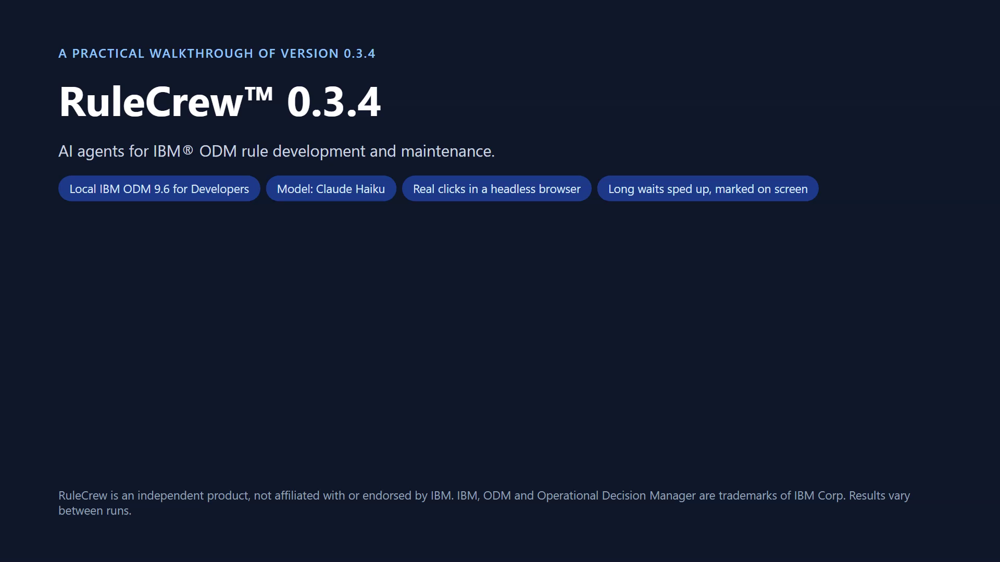

# RuleCrew™ – AI agents for IBM ODM rule maintenance

RuleCrew helps teams that maintain IBM Operational Decision Manager (ODM) rules. You ask for a change in plain
English; agents plan it, build it with ODM's own build command, run it before and after on ODM's engine, replay
known decisions, and show you every file to review before anything is written. It also answers questions about
existing rules and checks projects without any AI model.

## Demo (13 minutes)

- [Watch on YouTube](https://youtu.be/gS_DsnHsF78)
- [Download in full quality (1080p, 162 MB)](https://github.com/RuleCrew/RuleAgents/releases/download/demo-2026-11-10/RuleCrew-demo-1080p.mp4)
- [Download a smaller copy for phones (720p, 26 MB)](https://github.com/RuleCrew/RuleAgents/releases/download/demo-2026-11-10/RuleCrew-demo-720p.mp4)

| Time | Chapter |
|---|---|
| 0:00 | Introduction |
| 0:42 | Getting started |
| 1:31 | Checks that need no AI model |
| 4:03 | Business questions about existing rules |
| 4:39 | A change in a Rule Designer workspace |
| 6:05 | Evidence pack |
| 6:26 | Settings, history and costs |
| 6:59 | A change on a Decision Center working branch |
| 8:09 | Approver queue and the result in Decision Center |
| 8:59 | Generated test suite |
| 9:48 | Starting from a policy document |
| 10:24 | Deploying to the Rule Execution Server and a live decision |
| 11:33 | Prove my change |
| 12:00 | Rule Designer plugin (screenshots) |

The demo shows real runs. Where a change could not be fully checked, the video shows that too: a person reviews
and approves every change.

## Short videos by topic

- [Ask about your rules in plain English (3:34)](https://youtu.be/ok7-_NKXZTw)

## Download

Not available yet. A download will follow.

---

RuleCrew is an independent product, not affiliated with or endorsed by IBM. IBM, ODM, Operational Decision
Manager, Decision Center and Rule Designer are trademarks of IBM Corp. IBM ODM is proprietary software owned by
IBM. RuleCrew works with your own licensed ODM installation and does not include or distribute any IBM software.
